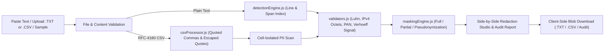

<div align="center">



# SENVY — Sensitive Data Protection

**"Detect it. Protect it. Share it safely."**

A 100% client-side, account-free browser data sanitization tool for detecting, classifying, reviewing, and redacting sensitive PII in plain text and RFC-4180 CSV files—without ever sending document data to any server.

</div>

---

## Live Sanitization Pipeline

<div align="center">



</div>

---

## Why SENVY?

Teams frequently paste customer logs, support tickets, or CSV exports into external tools without realizing personal identifiers are still present. **SENVY** provides an immediate, zero-upload browser workspace so users can inspect, verify, and sanitize sensitive information before sharing files externally.

- **Zero Server Uploads:** Every regex scan, checksum verification, CSV parse, masking pass, and file export executes locally in browser memory.
- **Completely Account-Free:** Opens directly into the main scanning workspace with no login, signup, passwords, or backend dependencies.
- **Zero Document Persistence:** No `fetch()`, `axios`, `XMLHttpRequest`, `localStorage`, or `sessionStorage` calls are used anywhere in the application.
- **Deterministic & Auditable:** Non-overlapping detections, category filters, manual review controls, and PII-free session audit reports.

---

## Architecture Overview



---

## Supported PII Categories & Validation

SENVY detects six core sensitive data categories and highlights each with a soft pastel tint in the original preview:

| Category | Highlight Color | Detection & Validation Logic | Confidence & Review Behavior |
| :--- | :---: | :--- | :--- |
| **Email Address** | `#F0EAF8` | Valid `local@domain.tld` pattern; rejects consecutive dots and malformed addresses | High confidence |
| **Indian Phone** | `#E8F1FA` | 10-digit Indian mobile numbers (`[6-9]xxxxxxxxx`), `+91`, `91-`, `0` trunk, 5-5 and 3-3-4 groupings | High with `+91`/context; Medium for bare 10 digits |
| **Indian PAN** | `#FAEFE4` | Structural `ABCDE1234F` (`[A-Z]{5}[0-9]{4}[A-Z]`) format check | High with standard 4th-char entity code or `PAN` context; flagged for review otherwise |
| **Aadhaar-like ID** | `#F7F3D9` | 12-digit (`4-4-4` or contiguous) candidates with context filtering (`order`/`invoice`/`tracking` excluded) + Verhoeff signal | High with explicit `Aadhaar` label + `[2-9]` start; unlabeled sequences flagged as **Needs Review** |
| **Payment Card** | `#F8E7E9` | 13–19 digit sequences (spaces/hyphens normalized) strictly validated with the **Luhn algorithm** | Rejects all invalid Luhn sequences; explicitly notes Luhn checks format only |
| **IPv4 Address** | `#E6F1ED` | Dotted-quad pattern with strict `0–255` bounds per octet and leading-zero rejection | Rejects invalid octets (e.g. `256.300.1.25`) and 5-octet strings |

---

## Three Redaction Modes

Switch modes live in **Redaction Studio** without modifying the original input:

| Mode | Example Transformation | Use Case |
| :--- | :--- | :--- |
| **1. Full Mask** | `riya.patel@gmail.com` → `[REDACTED]`<br>`9876543210` → `[REDACTED]`<br>`ABCDE1234F` → `[REDACTED]` | Maximum data minimization before public or external sharing |
| **2. Partial Mask** | `riya.patel@gmail.com` → `r***@g***.com`<br>`9876543210` → `******3210`<br>`ABCDE1234F` → `XXXXX1234X`<br>`1234 5678 9012` → `XXXX XXXX 9012`<br>`4111 1111 1111 1111` → `XXXX XXXX XXXX 1111`<br>`192.168.1.25` → `XXX.XXX.X.25` | Support triage and identity verification with minimal character exposure |
| **3. Consistent Pseudonymization** | `riya.patel@gmail.com` → `EMAIL_01`<br>`9876543210` → `PHONE_01`<br>`ABCDE1234F` → `PAN_01`<br>`123456789012` → `AADHAAR_01`<br>`4111111111111111` → `CARD_01`<br>`192.168.1.25` → `IP_01` | Preserves entity relationships across multi-line logs and CSV rows |

> **Canonical Consistency:** Repeated occurrences of the same entity (e.g., `riya.patel@gmail.com` appearing multiple times, or `+91 9876543210` and `9876543210`) normalize to the same synthetic identifier (`EMAIL_01`, `PHONE_01`), while distinct entities receive sequential IDs (`_02`, `_03`, ...).

---

## Key Capabilities

- **RFC-4180 CSV Handling:** Properly parses quoted fields with commas (e.g., `"Patel, Riya"`), escaped quotes (`""VIP""`), embedded newlines, and `\r\n` / `\n` endings. Inspect differences in **Raw CSV** or **Table View** and export structurally valid `.csv` files.
- **Category Filtering & Manual Review:** Toggle individual categories (`Select all` / `Deselect all`) to leave specific categories unredacted and visibly marked as excluded. Confirm uncertain detections or dismiss false positives individually in the **Detection Results** panel (which masks values by default).
- **Privacy & Risk Audit Report:** Tracks session events (file loaded, scan completed, mode changed, exported, cleared) without ever recording raw PII values. Computes a deterministic **Heuristic Exposure Summary** (`0–100`) with full weight documentation and an explicit disclaimer that it is a triage indicator rather than a legal certification.
- **One-Click Fictional Demo Samples:** Load synthetic **Sample Text** or **Sample CSV** (clearly labeled `DEMO DATA — NOT REAL PERSONAL INFORMATION`) demonstrating all 6 PII categories, repeated entities, and false-positive control strings.

---

## Tech Stack

- **Frontend:** React 19, Vite 8, Tailwind CSS v4 (`@tailwindcss/vite`), Lucide Icons (`lucide-react`)
- **Testing:** Node.js built-in test runner (`node:test`, `node:assert/strict`) + Vite SSR component verification
- **Architecture:** Modular client-side separation between detection, validation, masking, CSV processing, audit logging, and React UI

---

## Project Structure

```text
SENVY/
├── docs/
│   ├── senvy-banner.svg            # Animated hero banner SVG
│   └── senvy-redaction-demo.svg    # Animated 3-mode pipeline SVG
├── src/
│   ├── components/
│   │   ├── AboutSettingsPanel.jsx
│   │   ├── AuditPanel.jsx
│   │   ├── CategoryBreakdownCards.jsx
│   │   ├── CategoryFilters.jsx
│   │   ├── DashboardCards.jsx
│   │   ├── DetectionResults.jsx
│   │   ├── ExportActions.jsx
│   │   ├── Header.jsx
│   │   ├── HighlightedDocument.jsx
│   │   ├── InputWorkspace.jsx
│   │   ├── OriginalPreview.jsx
│   │   ├── PrivacyPanel.jsx
│   │   ├── RedactionModeSelector.jsx
│   │   ├── RedactionStudio.jsx
│   │   ├── SanitizedPreview.jsx
│   │   └── Sidebar.jsx
│   ├── constants/
│   │   ├── categories.js           # Category metadata, pastel colors, risk weights
│   │   └── sampleData.js           # Fictional TXT & CSV demo datasets
│   ├── engine/
│   │   ├── csvProcessor.js         # RFC-4180 CSV parser, cell scanner & serializer
│   │   ├── detectionEngine.js      # Pure JS PII detectors, overlap resolver & metrics
│   │   ├── maskingEngine.js        # Full, Partial & Consistent Pseudonymization engine
│   │   └── validators.js           # Luhn, IPv4 octets, PAN structure & Verhoeff
│   ├── utils/
│   │   ├── auditLogger.js          # PII-free event log & deterministic risk heuristic
│   │   ├── exportUtils.js          # Dated Blob downloads (YYYYMMDD) & clipboard helper
│   │   └── fileValidation.js       # Extension, size (5 MB), empty & binary checks
│   ├── App.jsx
│   ├── index.css
│   └── main.jsx
├── tests/
│   └── engine.test.js              # 18 automated unit, privacy & SSR component tests
├── index.html
├── package.json
└── vite.config.js
```

---

## Getting Started

### Prerequisites
- Node.js 20+ (tested on Node v24.21.0) and npm

### Installation & Development

```bash
git clone https://github.com/parlisojitra05/SENVY.git
cd SENVY
npm install
npm run dev
```

Open `http://localhost:5173/` in your browser.

### Available Scripts

| Command | Description |
| :--- | :--- |
| `npm run dev` | Starts the Vite local development server |
| `npm test` | Runs all 18 automated unit, privacy, and SSR tests (`node --test tests/engine.test.js`) |
| `npm run build` | Builds the optimized production bundle into `dist/` |
| `npm run preview` | Serves the production build locally for verification |

---

## Known Limitations

- Pattern-based detection cannot guarantee 100% recall on obfuscated or unconventional formats (e.g., spelled-out digits or non-Indian phone formats). Always review the **Detection Results** panel before sharing sensitive files.
- **Luhn validation** verifies check-digit integrity only and does not prove a payment card is real or active.
- Highlighted document preview rendering caps visual highlighting at `80,000` characters for UI smoothness while full scanning and export process files up to `5 MB`.
